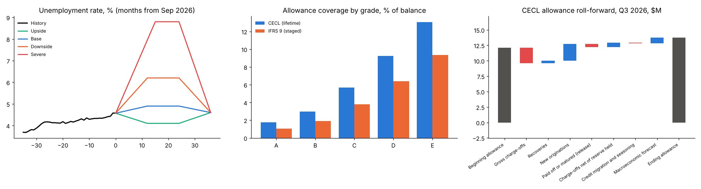

# Expected Credit Loss (CECL and IFRS 9)

The allowance for credit losses on a **$291M consumer installment loan book (33,629 open loans)**
at September 30, 2026, under both US **CECL** (lifetime losses on every loan) and **IFRS 9** (staged:
12-month losses until credit risk rises significantly).

The project covers:
- probability of default (PD) from a macro-driven delinquency transition model,
- loss given default (LGD) from recovery cash flows,
- four weighted unemployment scenarios,
- IFRS 9 staging,
- a Q2 to Q3 allowance roll-forward with the provision split by driver,
- an out-of-time backtest against a simple historical loss-rate method.

**[Open the reserve dashboard](https://martinogie.github.io/expected-credit-loss/)**: move the
scenario weights and watch the allowance change.



## Results at September 30, 2026

| | CECL | IFRS 9 |
|---|---|---|
| Allowance | **$13.77M** | **$9.23M** |
| Coverage (allowance ÷ balance) | 4.73% | 3.17% |
| June 30 allowance | $12.11M | $8.27M |

CECL allowance under each scenario, probability-weighted 15/45/30/10:

| Upside | Base | Downside | Severe | Weighted |
|---|---|---|---|---|
| $10.79M | $12.19M | $15.04M | $21.62M | $13.77M |

IFRS 9 stages:

| Stage | Loans | Balance | Allowance |
|---|---|---|---|
| 1: performing (12-month ECL) | 31,656 | $276.0M | $5.52M |
| 2: significant increase in credit risk (lifetime) | 1,807 | $13.8M | $2.83M |
| 3: 90+ days past due (lifetime) | 166 | $1.2M | $0.88M |

CECL allowance roll-forward, Q3 2026 ($M):

| Item | Amount |
|---|---|
| Beginning allowance, June 30 | 12.11 |
| Gross charge-offs | (2.51) |
| Recoveries | 0.43 |
| Provision: new originations | 2.71 |
| Provision: reserve released on loans that paid off or matured | (0.51) |
| Provision: replenishing charge-offs beyond the reserve already held | 0.71 |
| Provision: credit migration and seasoning | (0.10) |
| Provision: change in the macroeconomic forecast | 0.95 |
| **Ending allowance, September 30** | **13.77** |

Total provision is $3.75M. The roll-forward reconciles to the cent.

Backtest: fitted on data to March 2025, then scored on the next 12 months.

| 12-month charge-off rate | Actual | Transition model | Historical loss rate |
|---|---|---|---|
| Whole book | 3.95% | 3.81% | 3.33% |

What the numbers say:
- **The worse outlook drove $0.95M of the Q3 build.** The September scenarios have unemployment
  peaking at 4.9% (base) and 8.8% (severe), against 4.5% and 8.0% in June.
- **CECL needs $4.55M more than IFRS 9**, almost all on Stage 1 loans, where CECL books lifetime
  losses and IFRS 9 books 12 months.
- **1,014 of the 1,807 Stage 2 loans are current.** All of them are borrowers who cured from a
  delinquency in the last six months. Those borrowers re-default at about 2.5× the normal rate,
  so their 12-month PD at least doubles from origination. The other 793 are 30–89 days past due.
- **The historical loss-rate method understates losses by 16%.** The book shifted to riskier grades
  in 2025. The transition model prices each loan's grade, age and the economy, and lands within 4%.

## Method

| Component | Approach |
|---|---|
| PD | Four multinomial logistic models, one per delinquency state (current, 30, 60, 90 days past due). Each predicts next month's state (cure, stay, roll, prepay, charge off) from grade, months on book, unemployment and a recent-delinquency flag. Chaining them month by month gives each loan's charge-off probability in every future month, for any unemployment path. |
| LGD | 1 − present value of recoveries ÷ balance at charge-off, by grade. Only charge-offs with a full 12-month recovery window are used: A 76%, B 80%, C 84%, D 87%, E 90%. |
| EAD | Scheduled balance three months before charge-off, since borrowers stop paying when they go delinquent. Loans already delinquent keep today's balance. |
| Discounting | Each loan's own interest rate. |
| Scenarios | Four 24-month unemployment paths, then a 12-month reversion to a 4.6% long-run rate. Weights 15/45/30/10. |
| Staging (IFRS 9) | Stage 3 at 90+ days past due. Stage 2 at 30–89 days past due, or a 12-month PD at least double its level at origination and up at least 0.5 points. |
| Roll-forward | The Q3 book is valued under both June's and September's scenarios to isolate the macro effect. New loans, exits and charge-offs are measured loan by loan. |

## Quick start

```bash
pip install -r requirements.txt
python -m ecl.run                         # simulate, fit, Q2 + Q3 allowance, roll-forward, backtest, page (~1 min)
python -m unittest discover -s tests      # 7 tests
```

## Layout

```
ecl/macro.py      unemployment history and June / September scenario sets
ecl/data.py       synthetic loan book: originations, monthly delinquency transitions, recoveries
ecl/model.py      transition models and LGD estimation
ecl/engine.py     ECL projection, IFRS 9 staging, CECL and IFRS 9 allowances
ecl/analysis.py   quarter-end allowance, roll-forward, backtest, vintage curves
ecl/run.py        pipeline, reports, chart and project page
```

## Data note

All data is synthetic. It covers 70,000 loans originated from 2021 to 2026. Each month a loan's
next state is drawn from known effects: grade, seasoning (risk peaks around month 12),
unemployment, re-default after a cure, and a hidden borrower-level risk factor the models never
see. Because the true process is known, the models can be checked against it.

## How this was built

Built with AI-assisted coding. Model design, validation and review are my own.

## License

MIT
